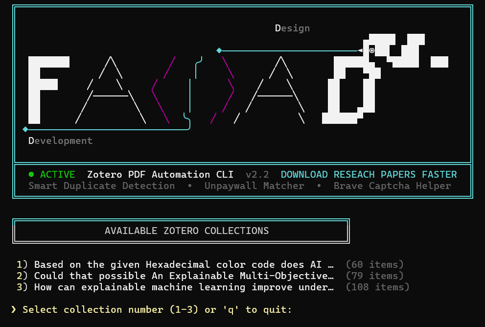
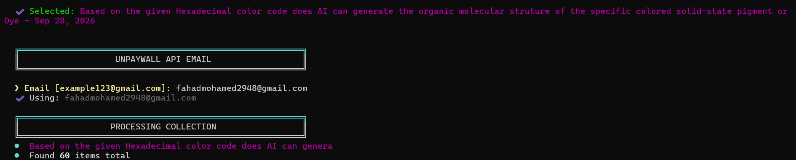
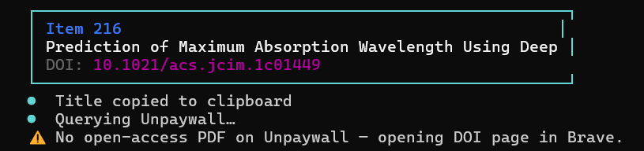
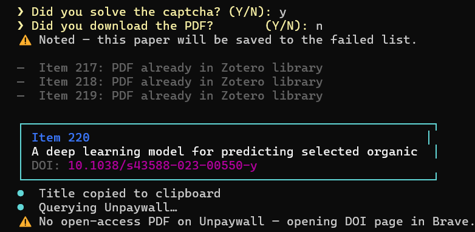

# ⚡ Zotero PDF Automation CLI (`Automate.py`)

<p align="center">
  
</p>

<p align="center">
  
  
  
  
  
</p>

---

## 📖 Overview

**Zotero PDF Automation CLI** is a high-performance terminal utility engineered for researchers, scientists, and academics to automate the tedious process of locating, retrieving, and organizing research paper full-text PDFs across large Zotero collections.

Whether papers are locked behind publisher paywalls or freely available as open-access preprints, this tool:

1. **Audits your local Zotero library** in real time (even while Zotero is actively running).
2. **Filters out existing attachments** using a comprehensive 3-tier duplicate detection algorithm.
3. **Fetches legal Open-Access PDFs** directly from the Unpaywall API.
4. **Handles paywalled/captcha-protected papers** by copying the title to your clipboard and opening the DOI in Brave Browser.
5. **Logs unretrieved articles** to a clean, UTF-8 CSV report named after your collection for batch handling.

---

## 📸 Visual Walkthrough

### 1. Startup & Interactive Collection Menu

Upon launching, the CLI initializes with a branded **FAHAD Design & Development** ASCII pixel banner and queries your local Zotero SQLite database to display all available collections along with live item counts:

<p align="center">
  
</p>

- **Dynamic Discovery**: Scans `collections` excluding soft-deleted folders in `deletedCollections`.
- **Numbered Navigation**: Select any collection instantly by entering its number (or `q` to quit).

---

### 2. Unpaywall Authentication & Collection Scan

Once a collection is chosen, the CLI configures your Unpaywall API email and prepares the items for automated processing:

<p align="center">
  
</p>

- **Default Email Support**: Remembers your preferred Unpaywall email; press <kbd>Enter</kbd> to accept or type an override.
- **Collection Counter**: Scans and displays the total number of references contained within the selected folder.

---

### 3. Automated DOI Query & Browser Fallback

For every paper lacking an attachment, the CLI queries Unpaywall for an open-access PDF. If unavailable, it seamlessly coordinates with Brave Browser:

<p align="center">
  
</p>

- **Card Layout**: Visualizes the Item ID, full title, and DOI.
- **Clipboard Sync**: Instantly copies the clean article title to your system clipboard so you can paste it into academic search portals or institutional proxies.
- **Direct DOI Launch**: Opens the official DOI URL in Brave Browser for manual download.

---

### 4. Interactive Captcha Wait & Verification State Machine

When manual interaction is needed (e.g., Cloudflare captchas, institutional SSO logins), the CLI pauses and prompts for verification:

<p align="center">
  
</p>

- **Captcha Synchronization**: `Did you solve the captcha? (Y/N)` ensures you have finished solving browser challenges before moving forward.
- **Download Confirmation**: `Did you download the PDF? (Y/N)` confirms whether the PDF was acquired.
- **Failed List Tracking**: If answered `N`, the DOI, Title, and Link are automatically logged for the end-of-run CSV export.
- **Smart Skip Engine**: Immediately detects if subsequent papers already have PDFs attached (e.g., `Item 217`, `Item 218`, `Item 219`) and skips them silently without interrupting your workflow.

---

## 🚀 Key Features

| Feature                              | Description                                                                                                                                                                                                                                                   |
| :----------------------------------- | :------------------------------------------------------------------------------------------------------------------------------------------------------------------------------------------------------------------------------------------------------------ |
| **🛡️ WAL-Safe Database Reader**      | Zotero locks `zotero.sqlite` with SQLite Write-Ahead Logging (WAL). `Automate.py` executes full checkpoints or creates isolated ephemeral snapshots of `.sqlite`, `.sqlite-wal`, and `.sqlite-shm`, enabling 100% read consistency while Zotero remains open. |
| **🔍 3-Tier Attachment Detection**   | Prevents false negatives by verifying attachments across three levels: (1) Direct child attachment in `itemAttachments`, (2) Library-wide duplicate DOI match, and (3) Exact title match across alternate editions.                                           |
| **🌐 Unpaywall API v2 Integration**  | Automates direct binary streaming of high-speed Open-Access publisher PDFs directly into your `~/Downloads/zotero_pdfs` folder.                                                                                                                               |
| **🦁 Brave Browser Auto-Detection**  | Automatically scans standard 64-bit, 32-bit, and user-local `AppData` paths for `brave.exe` to trigger isolated browser instances.                                                                                                                            |
| **📋 Automatic Clipboard Sync**      | Copies paper titles to the Windows Clipboard using `pyperclip` (with fallback to native `clip.exe`), eliminating manual typing when searching databases.                                                                                                      |
| **📊 CSV Failure Reporting**         | Generates formatted UTF-8-BOM CSV reports saved under `~/Downloads/zoteroCSV/<Collection_Name>.csv` listing papers that require manual institutional access.                                                                                                  |
| **💻 Zero Hardcoding & Portability** | Resolves user home paths via `os.path.expanduser("~")`, allowing the script to run seamlessly on any machine without configuration edits.                                                                                                                     |

---

## 📦 Requirements & Installation

### 1. Prerequisites

- **Python 3.10+**
- **Zotero** (installed in standard location: `%USERPROFILE%\Zotero`)
- **Brave Browser** (or default system browser)

### 2. Dependencies

Install the required lightweight Python libraries:

```powershell
pip install requests pyperclip colorama
```

---

## 💻 Usage Guide

1. Open your terminal (PowerShell, Command Prompt, or Windows Terminal).
2. Navigate to the project root and launch the script:
   ```powershell
   python Automate.py
   ```
3. **Select your Collection**: Input the index number corresponding to your target collection.
4. **Confirm Unpaywall Email**: Press <kbd>Enter</kbd> to accept your default email or provide a new one.
5. **Sit Back & Download**:
   - Open-access papers will be downloaded automatically.
   - For restricted papers, solve the browser prompt or captcha, grab your paper, and confirm in terminal.
6. **Review Reports**: Once finished, review downloaded PDFs in `Downloads/zotero_pdfs` and failed items in `Downloads/zoteroCSV`.

---

## 📂 Output File Structure

```text
C:\Users\<YourUsername>\
├── Downloads\
│   ├── zotero_pdfs\                     <-- Direct OA PDF downloads
│   │   ├── 10.1038_s41467-023-38192-3.pdf
│   │   └── 10.1021_acs.jcim.4c02403.pdf
│   └── zoteroCSV\                      <-- Failure logs for manual retrieval
│       └── Could that possible An Explainable...csv
└── Zotero\
    ├── zotero.sqlite                    <-- Live Zotero database
    ├── zotero.sqlite-wal                <-- Live Write-Ahead Log
    └── zotero.sqlite-shm                <-- Shared memory index
```

---

## 🛠️ Technical Deep Dive: SQLite WAL Concurrency

Zotero utilizes SQLite in **WAL (Write-Ahead Logging)** mode. While Zotero is open:

- Updates and newly added attachments reside in `zotero.sqlite-wal` and are not immediately checkpointed to the main `zotero.sqlite` database file.
- Standard read connections may experience stale reads or throw `sqlite3.OperationalError: database is locked`.

**How `Automate.py` Solves This:**

1. Executes an in-memory `PRAGMA wal_checkpoint(FULL)` to flush recent transactions into the database view.
2. In the event of an active OS file lock, it creates an isolated atomic shadow snapshot of the triple-file set (`.sqlite`, `.sqlite-wal`, `.sqlite-shm`) into an ephemeral directory via `tempfile.mkdtemp()`.
3. Opens the snapshot, resolves all relational queries, and cleanly unlinks temporary directories on termination through Python `finally` blocks.

---

## 👨‍💻 Author & Credits

- **Developer**: [@FahadhCodes](https://github.com/fahadhcodes)
